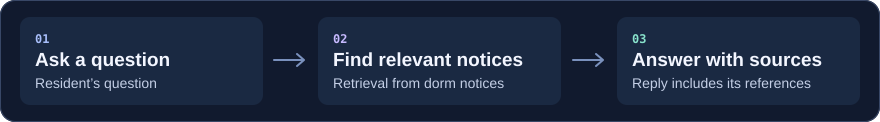

# 👋 Hi, I’m Sanghyun Yoon (윤상현)

I’m a computer engineering student at **Hansung University**, specializing in **Big Data**. I build AI tools that answer with sources and run machine learning experiments that show what changed, what worked, and what still needs testing.

📫 **Email:** [yoonsh0715@naver.com](mailto:yoonsh0715@naver.com)

## 🛠️ Tools I work with

## 🚀 Selected projects

| Project | What I built or tested |
| --- | --- |
| 📊 [Steam Review Helpfulness](https://github.com/Realysh/capstone_test) | Led the capstone team. I worked on problem definition, data augmentation and extraction, and model design. The repository documents three baselines: DMMN, HP-BERT, and TNN. |
| ⌨️ [Typing War](https://github.com/Realysh/typing-war-portfolio) | Helped build the initial Java Swing UI for a multiplayer typing game and verified the lobby flow using two TCP clients. |
| 🧪 [Hotel Review Augmentation](https://github.com/Realysh/prisim-lab-portfolio) | Compared how the number of examples and the hotel details in a prompt changed the length, sentiment, and name disclosure of generated reviews. |

## 💬 Dorm Chat · 길라자비스

I built a chatbot that finds relevant dorm notices before answering residents’ questions. It includes the sources in its replies so residents can check the original notices. This approach is called **retrieval-augmented generation (RAG)**.

🔗 **[View the Donghaeng (동행) KakaoTalk channel I built](https://pf.kakao.com/_rxeNNX)** · Source code and internal data are private.
